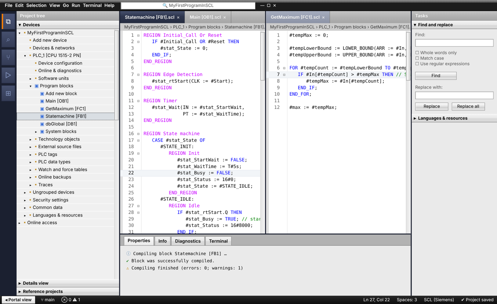
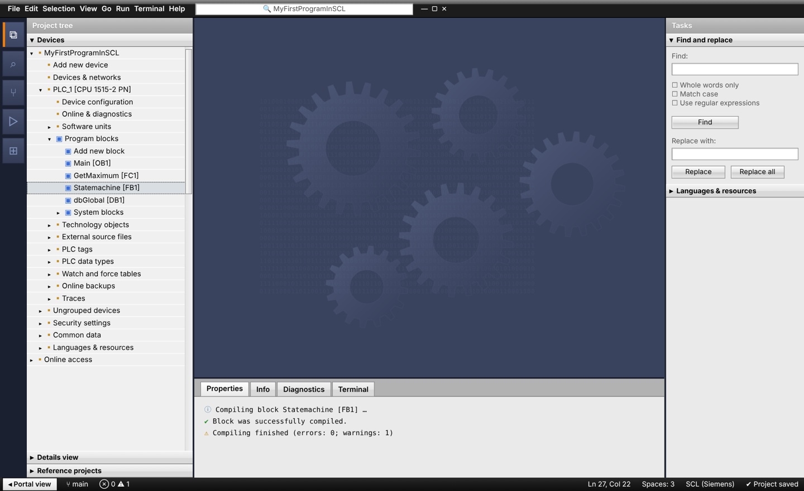
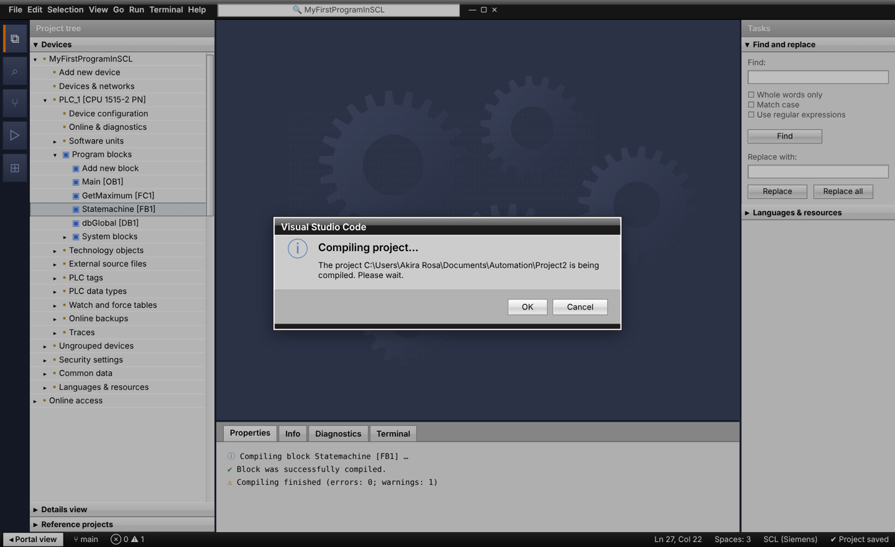

# TIA Portal Theme for VS Code

VS Code themes inspired by the Siemens **TIA Portal** engineering software, plus SCL syntax highlighting that colors your code exactly the way the TIA SCL editor does. Three themes are included:

- **TIA Portal**: the stylized one, a close replica of TIA Portal's look.
- **TIA Portal - White**: a calmer, flat light theme with Siemens petrol accents.
- **TIA Portal - Dark**: the same calmer style in dark petrol.



| No editor open — the gear work area | TIA-style dialogs and pickers |
|---|---|
|  |  |

## TIA Portal (stylized)

It follows TIA Portal's **Project View**, with the **Portal View's** navigation column mixed in. Colors were pixel-sampled from TIA Portal V16/V19:

- **Glossy black title strip** across the top, like the TIA window frame.
- **Navigation column** on the far left in Portal View navy (`#1B2030`), with slate buttons and the orange (`#FF8000`) active marker.
- **Project tree** with a gray `#B2B2B2` header bar, `#F0F0F0` body, white row lines and the dotted selection box.
- **Raised gradient section headers** (`#F3F3F3 → #D9D9D9`, `#6C6C6C` bottom edge) like "Devices" and "Details view".
- **Editor title bars**: navy `#2D354D` for the editor you're working in, gray `#B2B2B2` for the others, separated by `#1B2030` window borders.
- **Gear work area**: when no editor is open, the work area turns navy `#3A435E` with gears. As in TIA, that's all it shows. Open a block and the gears are gone.
- **Inspector-style panel tabs** (Properties / Info / Diagnostics look) and a **Tasks-style** secondary side bar.
- **Black bottom bar** like TIA's "Portal view" strip. It turns online-orange while you debug.
- **TIA dialog frames**: dialogs, the command palette and notifications get the black title strip, gray body, darker footer and white outer frame.
- **Classic always-visible scrollbars**, gradient push buttons and yellow tooltips.
- **SCL colors exactly like TIA**: keywords and data types blue `#0000FF`, whole `REGION …` lines magenta, comments green, and operands, numbers and literals plain black.

## TIA Portal - Simple

Two calmer, flat themes for everyday use. They need no extra setup: no CSS layer, just pick them.

| TIA Portal - light | TIA Portal - dark |
|---|---|
|  |  |

- **TIA Portal light** is a light gray-and-white workspace with Siemens petrol (`#009999`) accents and selection.
- **TIA Portal dark** is the dark petrol version for long sessions or dark rooms.
- Both turn the status bar online-orange while debugging.
- SCL code uses a slightly richer palette than TIA's editor: `#local` tags in petrol, literals in orange and strings in red, on top of TIA's blue keywords and green comments.

## Install

**From the Extensions view:** search for **TIA Portal Theme** and click **Install**.

**From a release file:**

1. Download the latest `tia-portal-vscode-theme-x.y.z.vsix` from the [Releases page](https://github.com/akira-rosa/tia-portal-vscode-theme/releases).
2. In VS Code open the Extensions view, click the `…` menu → **Install from VSIX…**, and pick the file.
   Or from a terminal: `code --install-extension tia-portal-vscode-theme-2.1.0.vsix`

Then press `Ctrl+K Ctrl+T` (macOS: `Cmd+K Cmd+T`) and choose **TIA Portal**, **TIA Portal – Portal View** or **TIA Portal – Project View**.

That gives you all the colors. For the stylized TIA Portal theme's gradients, glossy strips, bevels, dialog frames and gears, add the CSS layer below.

## Turning on the gradients and borders (CSS layer)

VS Code color themes can only set flat colors. Everything three-dimensional lives in [`css/tia-portal.css`](css/tia-portal.css), which you load with a custom-CSS extension.

1. Install **[Custom CSS and JS Loader](https://marketplace.visualstudio.com/items?itemName=be5invis.vscode-custom-css)** (`be5invis.vscode-custom-css`).
2. Copy `tia-portal.css` somewhere stable, for example `C:\Users\<you>\vscode-css\`. Download it from this repo, or copy it out of the installed extension at `~/.vscode/extensions/akira-rosa.tia-portal-vscode-theme-<version>/css/`, so extension updates don't break the path.
3. Add to your `settings.json` (note the `file:///` prefix and forward slashes):

   ```json
   "vscode_custom_css.imports": ["file:///C:/Users/<you>/vscode-css/tia-portal.css"],
   "window.titleBarStyle": "custom"
   ```

4. Run **Enable Custom CSS and JS** from the Command Palette (`Ctrl+Shift+P`), then fully close and reopen VS Code.

Things to know:

- VS Code will say your installation "appears to be corrupt". That's expected when CSS is injected; choose **Don't Show Again**.
- After every VS Code update, run **Reload Custom CSS and JS** again.
- On Windows with a system-wide install you may need to run VS Code as administrator once for step 4.
- Every rule is scoped to the stylized TIA Portal theme, so switching to Portal View, Project View or any other theme turns the CSS off.
- To remove it, run **Disable Custom CSS and JS** and restart.

For the full TIA feel, these settings help:

```json
"editor.fontFamily": "Consolas, 'Courier New', monospace",
"editor.fontSize": 13,
"editor.lineHeight": 17,
"workbench.tree.indent": 14
```

## SCL language support

The extension registers an `SCL (Siemens)` language for `.scl` and `.udt` files, so exported TIA sources (External source files) highlight correctly. It understands:

- `#LocalTag` and `#"Quoted local"` operands
- `"GlobalTag"` / `"Block_DB".Member` — double quotes are tag names in SCL, not strings
- `'strings'` with `$N`, `$'`, `$$` escapes
- typed and time literals: `T#2S`, `LT#5ms`, `TOD#12:00:00`, `16#00FF`, `2#1010`, `INT#5`
- `REGION <name> … END_REGION`, block keywords, `VAR_*` sections, `{ S7_Optimized_Access := 'TRUE' }` attribute lists
- `(* block *)`, `/* block */` and `// line` comments, folding and auto-indent

Data block sources use the `.db` extension, which VS Code won't claim automatically because it clashes with database files. To highlight them, add to your settings:

```json
"files.associations": { "*.db": "scl" }
```

## Customizing

The stylized theme and its CSS come from [`scripts/gen_theme.py`](scripts/gen_theme.py); Portal View and Project View come from [`scripts/gen_themes.py`](scripts/gen_themes.py). Change a palette value and regenerate:

```bash
python3 scripts/gen_theme.py      # TIA Portal theme + css/tia-portal.css
python3 scripts/gen_themes.py     # Portal View + Project View
```

For a quick personal tweak without rebuilding, override colors in your `settings.json`:

```json
"workbench.colorCustomizations": {
  "[TIA Portal]": { "editorGroup.emptyBackground": "#2D354D" }
},
"editor.tokenColorCustomizations": {
  "[TIA Portal]": {
    "textMateRules": [{ "scope": "variable.other.local.scl", "settings": { "foreground": "#00646E" } }]
  }
}
```

### Token scopes for SCL

| Element | Scope |
|---|---|
| `#Local` tag | `variable.other.local.scl` |
| `"Global"` tag | `variable.other.global.scl` |
| Control keywords (`IF`, `FOR`, …) | `keyword.control.scl` |
| Block / declaration keywords | `keyword.other.block.scl`, `keyword.other.declaration.scl` |
| `REGION` / `END_REGION` | `keyword.control.region.scl` |
| Region name | `entity.name.section.region.scl` |
| Data types | `support.type.primitive.scl` |
| Time / date literals | `constant.other.literal.scl` |
| Numbers | `constant.numeric.scl` |
| Instruction calls | `entity.name.function.scl` |
| Attribute lists `{ … }` | `meta.attribute.scl` |

Earlier experiments (separate Classic Project/Portal views) are kept in [`archive/`](archive/).

## Releasing a new version

1. Bump `version` in `package.json` and add a note to `CHANGELOG.md`.
2. Publish a GitHub release with a matching tag, such as `v2.2.0`.
3. The GitHub Actions workflow builds the `.vsix`, attaches it to the release, and publishes it to the VS Code Marketplace and Open VSX when the `VSCE_PAT` / `OVSX_PAT` repository secrets are set.

## Contributing

Issues and pull requests are welcome, especially color corrections from people with TIA Portal open side by side, and SCL grammar cases that highlight wrong. Please include a short SCL snippet that shows the problem.

## Disclaimer

This is an unofficial community project. It is not affiliated with, endorsed by, or sponsored by Siemens AG. SIEMENS, SIMATIC and TIA Portal are trademarks of Siemens AG and are used here only to describe what the theme is inspired by. No Siemens logos or artwork are included; the gear watermark is an original drawing.

## License

[MIT](LICENSE)
