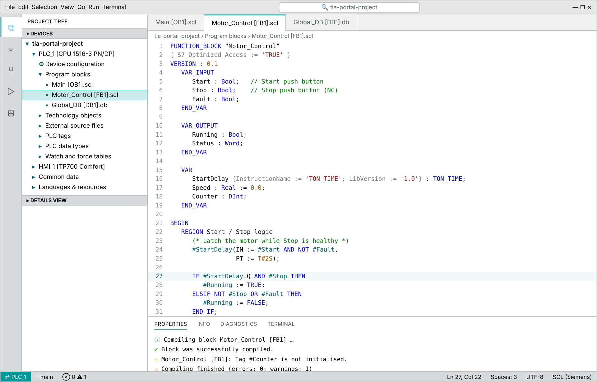
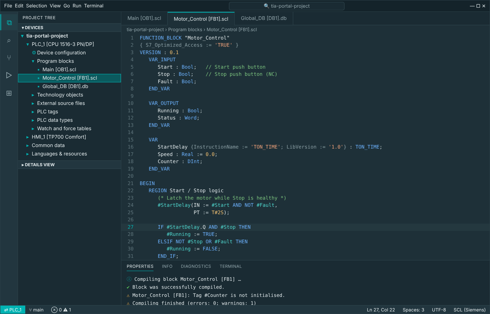

# TIA Portal Theme for VS Code

Two VS Code color themes inspired by the Siemens **TIA Portal** engineering software, plus SCL syntax highlighting that colors your code the way the TIA SCL editor does.

| TIA Portal – Project View (light) | TIA Portal – Portal View (dark) |
|---|---|
|  |  |

## What's inside

**TIA Portal – Project View** — the classic light engineering workspace: gray window chrome, white project tree and editor, Siemens petrol (`#009999`) accents and selection, gray section headers like the "Project tree" and task-card bars.

**TIA Portal – Portal View** — a dark petrol variant modeled on the TIA start screen, for long sessions or dark rooms.

Both themes share the same TIA touches:

- **Online-mode orange** — the status bar turns orange (`#FF9900`) while you debug, just like TIA Portal's title bars when you go online with a PLC.
- **Classic yellow tooltips** in the light theme, like TIA's hover help.
- **SCL editor colors** — keywords and data types in blue, comments in green, `#local` tags in petrol, `"global"` tags in plain text, strings in red, literals such as `T#2S` and `16#FF` in orange, pragmas in gray.

## SCL language support

The extension registers an `SCL (Siemens)` language for `.scl` and `.udt` files, so exported TIA sources (External source files) highlight correctly. It understands:

- `#LocalTag` and `#"Quoted local"` operands
- `"GlobalTag"` / `"Block_DB".Member` — double quotes are tag names in SCL, not strings
- `'strings'` with `$N`, `$'`, `$$` escapes
- typed and time literals: `T#2S`, `LT#5ms`, `TOD#12:00:00`, `16#00FF`, `2#1010`, `INT#5`
- `REGION … END_REGION`, block keywords, `VAR_*` sections, `{ S7_Optimized_Access := 'TRUE' }` attribute lists
- `(* block *)`, `/* block */` and `// line` comments, folding and auto-indent

Data block sources use the `.db` extension, which VS Code won't claim automatically (it clashes with database files). To highlight them, add to your settings:

```json
"files.associations": { "*.db": "scl" }
```

The themes work for every other language too; the SCL grammar just makes PLC code look like it does in TIA.

## Install

**From a release (easiest)**

1. Download the latest `tia-portal-vscode-theme-x.y.z.vsix` from the [Releases page](https://github.com/akira-rosa/tia-portal-vscode-theme/releases).
2. In VS Code open the Extensions view, click the `…` menu → **Install from VSIX…**, and pick the file.
   Or from a terminal: `code --install-extension tia-portal-vscode-theme-1.0.0.vsix`
3. Press `Ctrl+K Ctrl+T` (macOS: `Cmd+K Cmd+T`) and choose **TIA Portal – Project View** or **TIA Portal – Portal View**.

**From source**

```bash
git clone https://github.com/akira-rosa/tia-portal-vscode-theme.git
cd tia-portal-vscode-theme
npx @vscode/vsce package          # produces tia-portal-vscode-theme-<version>.vsix
code --install-extension tia-portal-vscode-theme-*.vsix
```

Or open the folder in VS Code and press `F5` to try it in an Extension Development Host window.

## Customizing

All colors come from two palettes at the top of [`scripts/gen_themes.py`](scripts/gen_themes.py). Change a value and regenerate:

```bash
python3 scripts/gen_themes.py      # rewrites themes/*.json
```

For a quick personal tweak without rebuilding, override colors in your VS Code `settings.json`:

```json
"workbench.colorCustomizations": {
  "[TIA Portal – Project View]": { "statusBar.background": "#CCEBEB" }
},
"editor.tokenColorCustomizations": {
  "[TIA Portal – Project View]": {
    "textMateRules": [{ "scope": "variable.other.local.scl", "settings": { "foreground": "#000000" } }]
  }
}
```

### Token scopes for SCL

| Element | Scope |
|---|---|
| `#Local` tag | `variable.other.local.scl` |
| `"Global"` tag | `variable.other.global.scl` |
| Control keywords (`IF`, `FOR`, …) | `keyword.control.scl` |
| Block / declaration keywords | `keyword.other.block.scl`, `keyword.other.declaration.scl` |
| `REGION` / `END_REGION` | `keyword.control.region.scl` |
| Data types | `support.type.primitive.scl` |
| Time / date literals | `constant.other.literal.scl` |
| Numbers | `constant.numeric.scl` |
| Instruction calls | `entity.name.function.scl` |
| Attribute lists `{ … }` | `meta.attribute.scl` |

## Releasing a new version

1. Bump `version` in `package.json` and add a note to `CHANGELOG.md`.
2. Tag and push: `git tag v1.1.0 && git push origin v1.1.0`.
3. The GitHub Actions workflow builds the `.vsix` and attaches it to a new release automatically.

## Contributing

Issues and pull requests are welcome — especially color corrections from people with TIA Portal open side by side, and SCL grammar cases that highlight wrong. Please include a short SCL snippet that shows the problem.

## Disclaimer

This is an unofficial community project. It is not affiliated with, endorsed by, or sponsored by Siemens AG. SIEMENS, SIMATIC and TIA Portal are trademarks of Siemens AG and are used here only to describe what the theme is inspired by. No Siemens logos or assets are included.

## License

[MIT](LICENSE)
