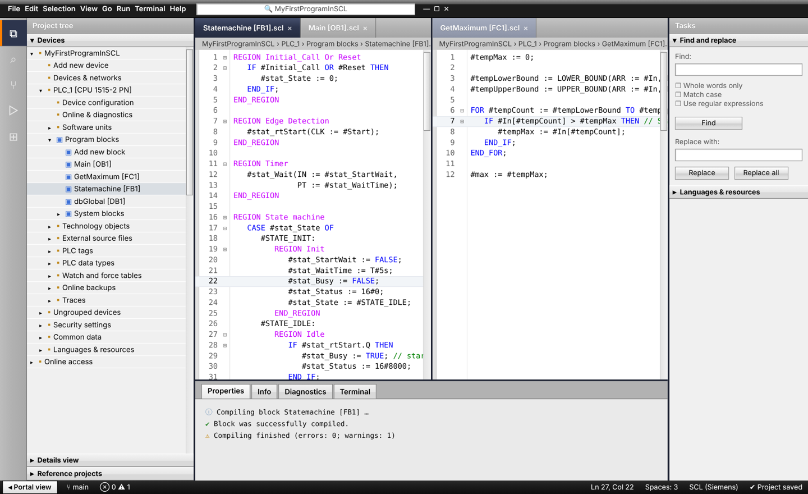
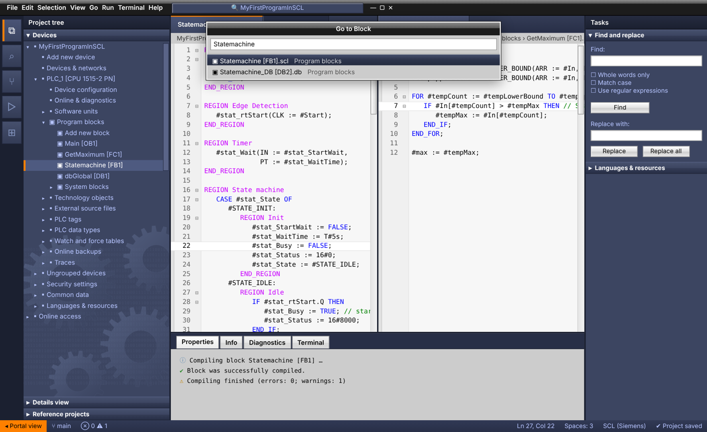
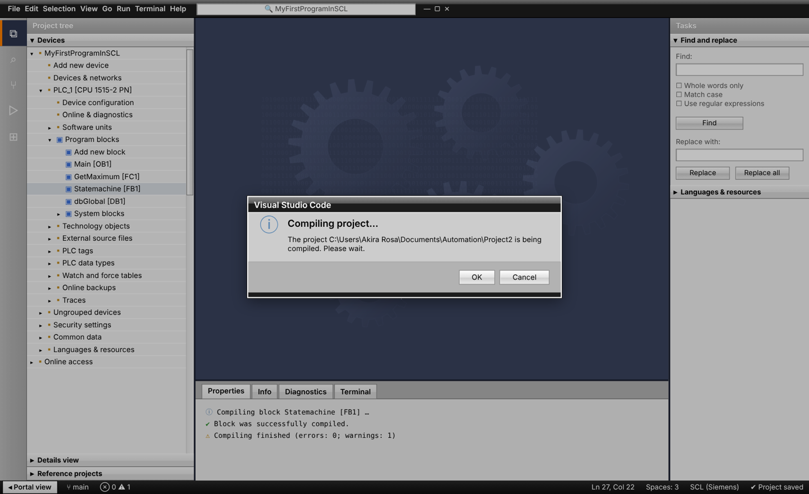
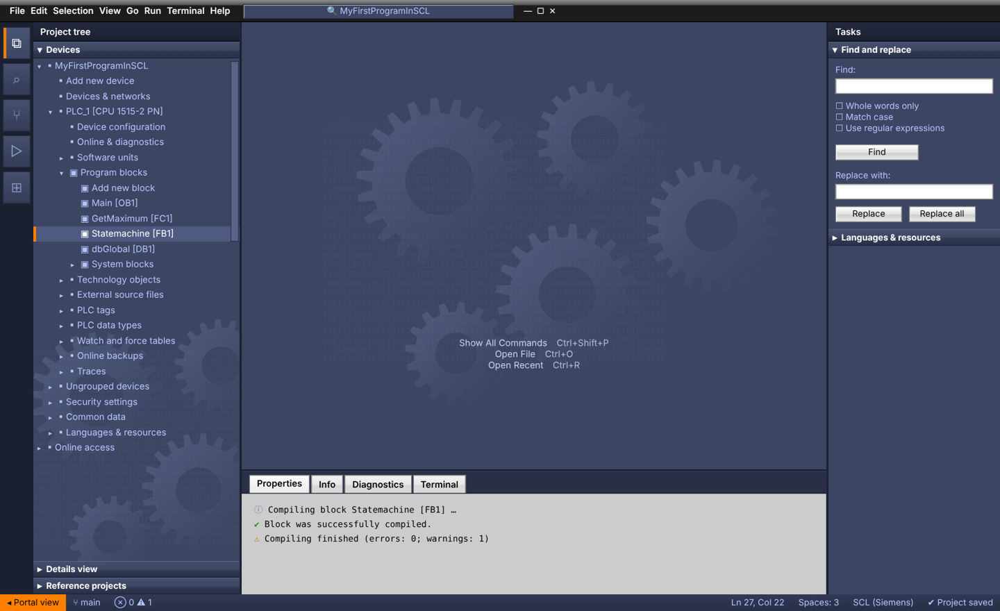

# TIA Portal Theme for VS Code

VS Code themes inspired by the Siemens **TIA Portal** engineering software, plus SCL syntax highlighting that colors your code the way the TIA SCL editor does. Two flavors:

- **Classic** — a close replica of the TIA Portal V16–V19 look: glossy black title strips, navy editor title bars, raised gradient tabs, the gear watermark, TIA dialog frames. Uses an optional CSS layer for the gradients and bevels.
- **Modern** — a cleaner, flat interpretation with Siemens petrol accents. Pure color theme, no extra setup.

## Classic themes

| TIA Portal Classic – Project View | TIA Portal Classic – Portal View |
|---|---|
|  |  |
|  |  |

Colors were pixel-sampled from TIA Portal V16/V19 screenshots:

- **Project View** — glossy black title strip, gray `#B2B2B2` header bars with white text, `#F0F0F0` project tree with dotted selection box, navy `#2D354D` active editor title bar (gray when inactive), `#1B2030` window separators, raised `#F3F3F3 → #D9D9D9` tabs and section headers, inspector-style panel tabs, navy empty workspace with gears, black "Portal view" bottom bar.
- **Portal View** — the start screen palette: `#1B2030` navigation column with orange `#FF8000` active marker, slate `#3C4561` panels with periwinkle `#B7C5FF` text and a gear watermark, `#CCCCCC` content areas, orange status item.
- **SCL coloring exactly like TIA** — keywords and types blue `#0000FF`, whole `REGION …` lines magenta, comments green, operands, numbers and literals plain black.
- **TIA dialog frames** — modal dialogs, the command palette and notifications get the black title strip, gray body, darker footer and white outer frame of TIA's dialogs.
- Classic Windows-style always-visible scrollbars, gradient push buttons, debugging turns the status bar online-orange.

### Turning on the gradients and borders (CSS layer)

VS Code color themes can only set flat colors. The gradients, bevels, glossy strips and the watermark live in [`css/tia-portal-classic.css`](css/tia-portal-classic.css), which you load with a custom-CSS extension. Without it the Classic themes still work, just flat.

1. Install **[Custom CSS and JS Loader](https://marketplace.visualstudio.com/items?itemName=be5invis.vscode-custom-css)** (`be5invis.vscode-custom-css`).
2. Copy `tia-portal-classic.css` somewhere stable (for example `C:\Users\<you>\vscode-css\`). You can download it from this repo, or find it inside the installed extension at `~/.vscode/extensions/akira-rosa.tia-portal-vscode-theme-<version>/css/` — copying it out means extension updates won't break the path.
3. Add to your `settings.json` (note the `file:///` prefix and forward slashes):

   ```json
   "vscode_custom_css.imports": ["file:///C:/Users/<you>/vscode-css/tia-portal-classic.css"],
   "window.titleBarStyle": "custom"
   ```

4. Run **Enable Custom CSS and JS** from the Command Palette (`Ctrl+Shift+P`), then restart VS Code (fully close it, don't just reload).
5. Pick **TIA Portal Classic – Project View** or **TIA Portal Classic – Portal View** with `Ctrl+K Ctrl+T`.

Things to know:

- VS Code will say your installation "appears to be corrupt" — that's expected when CSS is injected; choose **Don't Show Again**.
- After every VS Code update, run **Reload Custom CSS and JS** again.
- On Windows with a system-wide install you may need to run VS Code as administrator once for step 4.
- Every rule is scoped to the Classic themes, so switching to any other theme turns the CSS off automatically.
- To remove it, run **Disable Custom CSS and JS** and restart.

For the full TIA feel, these settings help:

```json
"editor.fontFamily": "Consolas, 'Courier New', monospace",
"editor.fontSize": 13,
"editor.lineHeight": 17,
"workbench.tree.indent": 14
```

## Modern themes

| TIA Portal – Project View (light) | TIA Portal – Portal View (dark) |
|---|---|
|  |  |

**TIA Portal – Project View** — the light engineering workspace: gray window chrome, white project tree and editor, Siemens petrol (`#009999`) accents and selection, gray section headers like the "Project tree" and task-card bars.

**TIA Portal – Portal View** — a dark petrol variant for long sessions or dark rooms.

Both modern themes share the same TIA touches:

- **Online-mode orange** — the status bar turns orange (`#FF9900`) while you debug, just like TIA Portal's title bars when you go online with a PLC.
- **Classic yellow tooltips** in the light theme, like TIA's hover help.
- **SCL editor colors** — keywords and data types in blue, comments in green, `#local` tags in petrol, `"global"` tags in plain text, strings in red, literals such as `T#2S` and `16#FF` in orange, pragmas in gray.

## SCL language support

The extension registers an `SCL (Siemens)` language for `.scl` and `.udt` files, so exported TIA sources (External source files) highlight correctly. It understands:

- `#LocalTag` and `#"Quoted local"` operands
- `"GlobalTag"` / `"Block_DB".Member` — double quotes are tag names in SCL, not strings
- `'strings'` with `$N`, `$'`, `$$` escapes
- typed and time literals: `T#2S`, `LT#5ms`, `TOD#12:00:00`, `16#00FF`, `2#1010`, `INT#5`
- `REGION … END_REGION`, block keywords, `VAR_*` sections, `{ S7_Optimized_Access := 'TRUE' }` attribute lists
- `(* block *)`, `/* block */` and `// line` comments, folding and auto-indent

Data block sources use the `.db` extension, which VS Code won't claim automatically (it clashes with database files). To highlight them, add to your settings:

```json
"files.associations": { "*.db": "scl" }
```

The themes work for every other language too; the SCL grammar just makes PLC code look like it does in TIA.

## Install

**From a release (easiest)**

1. Download the latest `tia-portal-vscode-theme-x.y.z.vsix` from the [Releases page](https://github.com/akira-rosa/tia-portal-vscode-theme/releases).
2. In VS Code open the Extensions view, click the `…` menu → **Install from VSIX…**, and pick the file.
   Or from a terminal: `code --install-extension tia-portal-vscode-theme-1.0.0.vsix`
3. Press `Ctrl+K Ctrl+T` (macOS: `Cmd+K Cmd+T`) and pick one of the four themes. For the Classic ones, also set up the [CSS layer](#turning-on-the-gradients-and-borders-css-layer).

**From source**

```bash
git clone https://github.com/akira-rosa/tia-portal-vscode-theme.git
cd tia-portal-vscode-theme
npx @vscode/vsce package          # produces tia-portal-vscode-theme-<version>.vsix
code --install-extension tia-portal-vscode-theme-*.vsix
```

Or open the folder in VS Code and press `F5` to try it in an Extension Development Host window.

## Customizing

Modern theme colors come from the palettes in [`scripts/gen_themes.py`](scripts/gen_themes.py); the Classic themes and their CSS come from [`scripts/gen_classic.py`](scripts/gen_classic.py). Change a value and regenerate:

```bash
python3 scripts/gen_themes.py      # rewrites the Modern themes
python3 scripts/gen_classic.py     # rewrites the Classic themes + css/tia-portal-classic.css
```

For a quick personal tweak without rebuilding, override colors in your VS Code `settings.json`:

```json
"workbench.colorCustomizations": {
  "[TIA Portal – Project View]": { "statusBar.background": "#CCEBEB" }
},
"editor.tokenColorCustomizations": {
  "[TIA Portal – Project View]": {
    "textMateRules": [{ "scope": "variable.other.local.scl", "settings": { "foreground": "#000000" } }]
  }
}
```

### Token scopes for SCL

| Element | Scope |
|---|---|
| `#Local` tag | `variable.other.local.scl` |
| `"Global"` tag | `variable.other.global.scl` |
| Control keywords (`IF`, `FOR`, …) | `keyword.control.scl` |
| Block / declaration keywords | `keyword.other.block.scl`, `keyword.other.declaration.scl` |
| `REGION` / `END_REGION` | `keyword.control.region.scl` |
| Data types | `support.type.primitive.scl` |
| Time / date literals | `constant.other.literal.scl` |
| Numbers | `constant.numeric.scl` |
| Instruction calls | `entity.name.function.scl` |
| Attribute lists `{ … }` | `meta.attribute.scl` |

## Releasing a new version

1. Bump `version` in `package.json` and add a note to `CHANGELOG.md`.
2. Tag and push: `git tag v1.1.0 && git push origin v1.1.0`.
3. The GitHub Actions workflow builds the `.vsix` and attaches it to a new release automatically.

## Contributing

Issues and pull requests are welcome — especially color corrections from people with TIA Portal open side by side, and SCL grammar cases that highlight wrong. Please include a short SCL snippet that shows the problem.

## Disclaimer

This is an unofficial community project. It is not affiliated with, endorsed by, or sponsored by Siemens AG. SIEMENS, SIMATIC and TIA Portal are trademarks of Siemens AG and are used here only to describe what the theme is inspired by. No Siemens logos or assets are included.

## License

[MIT](LICENSE)
